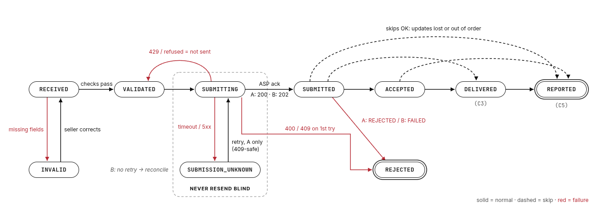

# Part 1: Submitting and tracking invoices across ASPs

Finkraft sits at C1's side of the five-corner model. We never talk to C3 or C5
directly; everything we know about them comes through the seller's ASP (C2).
The one rule everything below serves: an invoice is never lost and never
submitted twice. When those two pull in different directions, I pick "never
twice" and make "never lost" a visible queue someone has to clear.

## 1. Adapter contract

One interface per ASP. Adapters only translate one HTTP exchange into Finkraft's
vocabulary. They don't touch storage or state; the service decides what a result means.

```python
class SubmitOutcome(StrEnum):
    ACKNOWLEDGED       # ASP took it, we have its id
    ALREADY_SUBMITTED  # ASP already has it (A's 409), we have its id
    REJECTED           # content refused; don't retry as is
    NOT_SENT           # definitely not stored (429, refused connection); safe to retry
    UNKNOWN            # timeout / 5xx / anything undocumented; may be stored

@dataclass(frozen=True)
class SubmitResult:
    outcome: SubmitOutcome
    submission_id: str | None       # A: submission_id, B: job_id
    state: InvoiceState | None      # status in the submit response, if any
    errors: tuple[AspError, ...]    # AspError(rule, message, field), normalised
    retry_after_s: float | None

@dataclass(frozen=True)
class StatusUpdate:
    submission_id: str
    state: InvoiceState             # already mapped to our states
    asp_status: str                 # raw value, kept for audit
    errors: tuple[AspError, ...]

class AspAdapter(Protocol):
    asp_id: str
    status_delivery: Literal["poll", "webhook"]
    rejects_duplicates: bool        # is a resend after a timeout safe?
    def submit(self, invoice: Invoice) -> SubmitResult: ...
    def fetch_status(self, submission_id: str) -> StatusUpdate: ...   # A
    def parse_webhook(self, body: dict) -> StatusUpdate: ...          # B
```

The two flags carry the real differences between the ASPs, so the service never
checks which ASP it's talking to. Errors from both formats become one
`AspError(rule, message, field)`: A's `{"code": "E104", "field": "BT-48"}` becomes
`rule="E104", field="BT-48"`, and each entry in B's `errors[]` becomes one
`AspError` with no field.

An invoice records the `asp_id` it was sent to and keeps it. A seller switching ASP
changes where *new* invoices go; anything already at the old ASP is tracked there to
the end. Adding an ASP is a new adapter class. A seller using two ASPs at once only turns
the seller → ASP setting into a routing rule; tracking already keys on the invoice's `asp_id`.

## 2. Invoice state machine



Finkraft's states: RECEIVED, INVALID, VALIDATED, SUBMITTING, SUBMISSION_UNKNOWN,
SUBMITTED, ACCEPTED, REJECTED, DELIVERED, REPORTED. Every change goes through one
`transition()` function that rejects anything not in the table.

| Finkraft | ASP A | ASP B |
|---|---|---|
| SUBMITTED | RECEIVED (200 on submit) | QUEUED (202 on submit) |
| ACCEPTED | VALIDATED | ACCEPTED |
| REJECTED | REJECTED, or 400 on submit | FAILED |
| DELIVERED (C3) | DELIVERED | BUYER_RECEIVED |
| REPORTED (C5) | REPORTED | TAX_CONFIRMED |

SUBMITTING and SUBMISSION_UNKNOWN are kept apart on purpose. SUBMITTING goes back
to VALIDATED only when the ASP definitely didn't store the invoice. A timeout goes
to SUBMISSION_UNKNOWN, and from there the only ways out are a duplicate-safe retry
or reconciliation, never a plain resend.

After SUBMITTED, forward skips are allowed (SUBMITTED straight to REPORTED),
because updates get lost or arrive out of order.

## 3. Failure handling

| Failure | Handling |
|---|---|
| Duplicate upload | Unique `(seller_id, invoice_number)` in Finkraft, checked before any ASP call, whichever ASP the seller uses. In production this is a DB unique constraint. |
| ASP A timeout after it stored the invoice | SUBMISSION_UNKNOWN. Retry with the same number; A answers 409 with the existing `submission_id` (assumption), and we track that. Stored once. |
| ASP A 409 on the *first* attempt | Someone sent that number outside Finkraft. REJECTED with `DUPLICATE_AT_ASP`; we don't adopt someone else's submission. |
| ASP B timeout on submit | B has no duplicate check and no lookup, so a resend could create a second tax record. SUBMISSION_UNKNOWN, no automatic resend. We send our invoice id as a client reference (`StatusUpdate.client_ref`); when B's webhook for it arrives (assumption: B echoes the reference), it resolves the invoice. Otherwise it goes to an ops queue. |
| Rate limit (A, 10 req/s) | A 429 is NOT_SENT: back to VALIDATED, but a 429 on a retry after a timeout stays SUBMISSION_UNKNOWN (the first attempt may have landed). Production adds a token bucket per ASP, shared by submits and polls. |
| Duplicate, late or out-of-order status updates | Updates only move forward. Repeated or older ones are recorded in history and ignored. TAX_CONFIRMED before BUYER_RECEIVED ends in REPORTED. |
| Contradictory update (FAILED after ACCEPTED) | Not applied. The invoice goes to a review queue. We don't raise, so one bad update can't stop a poll run or make B redeliver forever. |
| Webhook before we've linked the job_id | Parked, then applied as soon as the submit response links it. |
| Crash between the state change and the ASP call | Production: the state change and an outbox row commit in one transaction, and a worker makes the call. A SUBMITTING row older than the call timeout becomes SUBMISSION_UNKNOWN. |
| Forged webhooks | Production: verify B's signature before parsing. |

## 4. Trade-offs

**Never resend an unknown submission to an ASP without duplicate checks.**
That guarantees no double submission at ASP B, which matters more than anything
else for tax data. I gave up full automation: some ASP B invoices sit in a
reconciliation queue until a webhook or a person resolves them, so they take longer to
reach the buyer and cost ops time. With ASP A the 409 makes retrying safe, so
there's no such cost there.

**One linear status instead of separate C3 and C5 tracks.** One state, with
forward-only updates, makes out-of-order handling a single comparison and keeps the
model easy to reason about. I gave up knowing that C3 happened when C5 is reported
first: the late BUYER_RECEIVED is ignored and only kept in history. If customers need
"delivered" and "reported" as separate facts (for example to chase buyers), I'd split
these into two timestamps on the invoice and keep the state for the submission
lifecycle only.

Full list of assumptions: README, "Assumptions".
